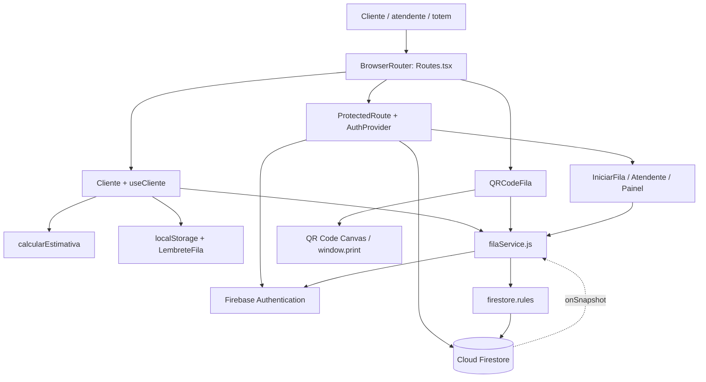
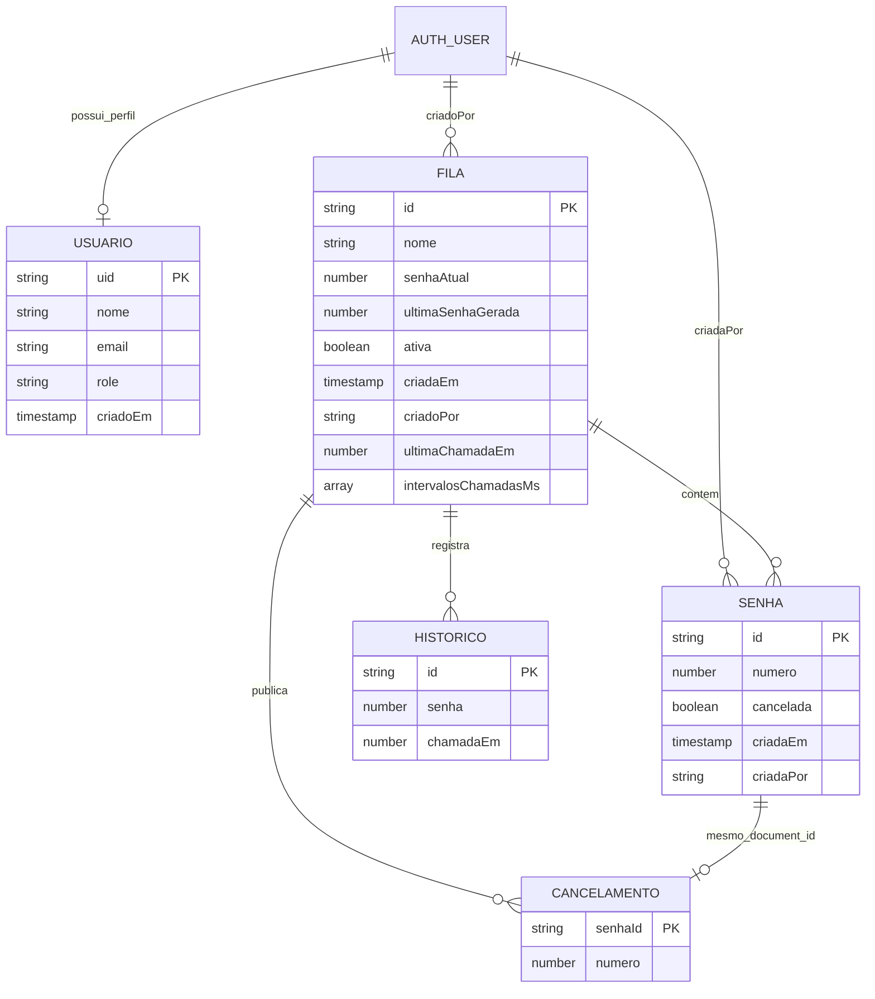

# Auditoria técnica — SuaVez / Fila Digital

Data: 21/09/2026. Base analisada: commit `f6a4fdd1ca53065d2559486ed28c9b77bdcc07a6`, com árvore de trabalho inicialmente limpa.

Este relatório fornece material técnico para o TCC e descreve o comportamento encontrado, inclusive limitações. Não constitui avaliação empírica de satisfação, desempenho em produção ou conformidade jurídica.

## Escopo e método

Foram examinados todos os arquivos autorais versionados: configurações, código TS/TSX/JS, estilos CSS/SCSS, regras do Firestore, HTML, SVGs, referências aos recursos visuais, manifesto, lockfile e README anterior (que continha somente `# SuaVez`). A estrutura local também foi inspecionada. `.env.local` foi conferido somente quanto aos nomes das variáveis, sem reproduzir valores. Dependências instaladas e artefatos gerados não foram tratados como código autoral; as versões foram comparadas ao lockfile. A pasta local `functions/` contém apenas `node_modules/`, sem implementação de funções versionada.

Não foram encontrados testes versionados, migrations, esquema formal de banco, Dockerfile, docker-compose, CI/CD, `firebase.json`, `.firebaserc`, `firestore.indexes.json`, configuração de emuladores, licença ou documentação adicional anterior. Não há `requirements.txt` nem `pom.xml`. Não foi acessada uma wiki remota nem o console Firebase. Sobre regras efetivamente publicadas, índices, região, plano, usuários, dados reais e implantação: **não foi possível confirmar isso apenas pelo código**.

As classificações usadas são: **implementado** (evidência direta), **inferência** (interpretação arquitetural ou consequência da leitura), **proposta** (trabalho futuro) e **não verificado em execução**. Os achados de regras são análise estática; não foram realizados ataques nem escritas no banco remoto.

## 1. Visão geral do projeto

O SuaVez é uma aplicação web de gerenciamento de filas de atendimento por senhas numéricas. O fluxo permite que um responsável abra filas, que clientes retirem senhas pelo celular ou por um totem e que o atendimento avance por chamadas. A interface informa a senha atual, a quantidade de pessoas à frente e uma estimativa de espera.

O problema tratado é a organização da ordem de atendimento e a visibilidade da espera, permitindo acompanhamento pelo navegador. Recepção, triagem e caixa aparecem como exemplos no campo de criação de fila; não há implementação específica para saúde, bancos ou comércio. O benefício de reduzir deslocamentos, aglomerações ou ansiedade é uma hipótese de aplicação; não há estudo de campo que o demonstre neste repositório.

| Ator | Uso real |
| --- | --- |
| Atendente / administrador | Cadastra conta por e-mail e senha, cria e administra suas próprias filas |
| Cliente | Acessa um link público, obtém identidade anônima quando necessário, retira e acompanha uma senha |
| Operador do monitor | Abre painel autenticado para exibição da chamada |
| Usuário do totem | Escaneia QR Code ou gera comprovante para impressão pelo navegador |

“Administrador” e “atendente” são denominações de interface para o mesmo papel persistido, `role: "atendente"`. Não existe hierarquia entre esses papéis. O sistema é uma SPA para navegadores de computador e celular, sem aplicativo nativo, CLI de negócio, PWA ou backend HTTP próprio identificável.

## 2. Arquitetura

### 2.1 Classificação

**Inferência:** frontend único organizado por páginas e componentes, com separação parcial entre apresentação, estado e serviços, apoiado em Backend as a Service (Firebase Authentication e Cloud Firestore). Não há evidência de MVC formal, microserviços próprios, servidor Express ou ORM.

`src/main.tsx` monta `React.StrictMode`, `AuthProvider` e `App`; `App.tsx` entrega `Router`. `Routes.tsx` define a navegação. `ProtectedRoute.tsx` consulta o contexto de autenticação. As páginas chamam `filaService.js`, que acessa diretamente o Firestore. O cadastro é uma exceção à centralização: `AuthContext.tsx` grava o perfil diretamente.



O desenho representa as regras como barreira lógica das operações do SDK; elas são executadas no serviço Firebase, não dentro do navegador.

### 2.2 Fluxos principais

1. **Cadastro:** `Cadastro.enviar` valida confirmação e envia nome/e-mail normalizados a `AuthProvider.cadastrar`; `createUserWithEmailAndPassword` cria identidade; `setDoc` cria `usuarios/{uid}` com `serverTimestamp`; a interface navega para `/`. Em falha do perfil, ocorre logout, mas a identidade criada não é removida.
2. **Abertura:** `IniciarFila.iniciar` aplica `trim()` e o padrão `Fila principal`; `criarFila` usa `addDoc` e retorna ID; navegação para `/admin/{id}`.
3. **Emissão:** `useCliente.pegarSenha` ou `QRCodeFila.retirarSenha` chama `gerarSenha`; `obterUsuarioPublico` reutiliza a identidade atual ou chama `signInAnonymously`; a transação lê a fila, cria a senha e incrementa `ultimaSenhaGerada`. O cliente móvel armazena `{numero, senhaDocId}` em `localStorage`; o totem guarda apenas o número no estado da tela.
4. **Acompanhamento:** listeners recebem fila, senha própria e projeção pública de cancelamentos; posição é derivada no navegador; `calcularEstimativa` é atualizado a cada segundo enquanto há espera.
5. **Chamada:** `Atendente.chamar` solicita `chamarProximaSenha`; a função consulta senhas ordenadas, escolhe a primeira não cancelada acima do contador atual, atualiza fila e grava histórico na mesma transação. Painel e cliente reagem via snapshots.
6. **Cancelamento:** primeira interação ativa `confirmando`; a segunda chama `cancelarSenha`, que atualiza senha e projeção `cancelamentos` atomicamente.
7. **Encerramento:** confirmação em `Atendente` chama `finalizarFila`, grava apenas `ativa: false` e retorna à lista. Os documentos permanecem no banco.

As assinaturas devolvem funções de cancelamento usadas nos efeitos React. Não existe polling HTTP implementado para a fila; os intervalos de um segundo são relógios locais para estimativa e lembrete.

## 3. Stack tecnológica

### 3.1 Linguagens e versões

TypeScript/TSX compõe páginas, contexto e tipos; JavaScript ESM compõe serviço e configuração Firebase; HTML fornece o ponto de montagem; CSS e SCSS definem apresentação; a linguagem de Security Rules usa `rules_version = '2'`. O alvo TypeScript é `ES2020`, com módulos `ESNext`, resolução `Bundler`, JSX `react-jsx` e `strict: true`. ES2020 é configuração de compilação, não versão de um interpretador JavaScript distribuído pelo projeto.

Versões declaradas são intervalos; versões exatas abaixo vêm de `package-lock.json` e coincidiram com as instalações diretas locais:

| Pacote | package.json | Lockfile / instalado | Papel |
| --- | --- | --- | --- |
| firebase | ^12.10.0 | 12.10.0 | Auth e Firestore |
| qrcode.react | ^4.2.0 | 4.2.0 | QRCodeCanvas |
| react | ^19.2.0 | 19.2.4 | Componentes e hooks |
| react-dom | ^19.2.0 | 19.2.4 | Renderização DOM |
| react-router-dom | ^7.13.1 | 7.13.1 | Rotas SPA |
| sass | ^1.99.0 | 1.99.0 | Compilação SCSS |
| @eslint/js | ^9.39.1 | 9.39.3 | Regras JS |
| @types/react | ^19.2.7 | 19.2.14 | Tipos React |
| @types/react-dom | ^19.2.3 | 19.2.3 | Tipos React DOM |
| @vitejs/plugin-react | ^5.1.1 | 5.1.4 | Integração React/Vite |
| eslint | ^9.39.1 | 9.39.3 | Análise estática |
| eslint-plugin-react-hooks | ^7.0.1 | 7.0.1 | Regras de hooks, somente arquivos abrangidos pelo lint |
| eslint-plugin-react-refresh | ^0.4.24 | 0.4.26 | Regras de atualização em desenvolvimento |
| globals | ^16.5.0 | 16.5.0 | Globais do navegador para lint |
| sass-embedded | ^1.98.0 | 1.98.0 | Compilador Sass integrado |
| typescript | ^7.0.2 | 7.0.2 | Checagem de tipos |
| vite | ^7.3.1 | 7.3.1 | Servidor de desenvolvimento e build |

O lockfile usa formato 3, com 362 entradas de pacotes além da raiz; inclui variantes opcionais de plataforma que não devem ser confundidas com pacotes efetivamente carregados. O [inventário de dependências](DEPENDENCIAS.md) registra caminhos e versões de todas essas entradas.

Ambiente observado: Node.js `v22.19.0`, npm `10.9.3`. O projeto não fixa Node/npm via `engines`, `.nvmrc` ou `packageManager`. A entrada do Vite no lockfile exige Node `^20.19.0 || >=22.12.0`.

### 3.2 Persistência e integrações

Cloud Firestore é o único banco acessado. A motivação original da escolha não foi registrada; **não foi possível confirmar isso apenas pelo código**. A aderência a documentos, listeners e transações permite inferir conveniência para sincronização entre telas com pouca infraestrutura própria.

Authentication gerencia identidade por e-mail/senha e anônima. `databaseURL`, `storageBucket`, `messagingSenderId` e `measurementId` aparecem na configuração, mas não há inicialização de Realtime Database, Storage, Messaging ou Analytics. Não devem ser descritos como funcionalidades integradas. O QR Code é gerado localmente, sem API externa. Impressão usa o navegador, sem driver ou protocolo próprio de impressora. Não foram encontrados `fetch`, Axios, pagamentos, SMS, WhatsApp ou e-mails transacionais autorais.

Build: Vite com plugin React, sem configuração extra. Testes: nenhuma ferramenta ou script próprio. CI/CD e containerização: ausentes. Hospedagem utilizada: **não foi possível confirmar isso apenas pelo código**.

## 4. Estrutura de pastas e arquivos

| Caminho | Responsabilidade |
| --- | --- |
| `src/main.tsx` | Montagem, validação da presença de `#root`, contexto e StrictMode |
| `src/App.tsx` | Composição do roteador |
| `src/index.css` | Reset, tipografia, links, botões e foco globais |
| `src/App.css` | Estilos remanescentes de template, sem import encontrado |
| `src/global.d.ts` | Tipos de `vite/client` e declaração de imports CSS/SCSS |
| `src/routes/Routes.tsx` | Todas as rotas de navegação |
| `src/routes/ProtectedRoute.tsx` | Barreira de identidade não anônima |
| `src/firebase/firebaseConfig.js` | Inicialização única de app, Auth e Firestore |
| `src/firebase/AuthContext.tsx` | Sessão e operações de cadastro/login/logout |
| `src/services/filaService.js` | Persistência, consultas, transações e listeners |
| `src/pages/Auth/` | `Login.tsx`, `Cadastro.tsx`, `Auth.styles.scss` |
| `src/pages/IniciarFila/` | Controlador `IniciarFila.tsx` e apresentação `componentes/InicioFila/InicioFila.tsx`, com SCSS |
| `src/pages/Atendente/` | Administração e histórico em `Atendente.tsx`, com SCSS |
| `src/pages/Painel/` | Exibição da chamada em `Painel.tsx`, com SCSS |
| `src/pages/Cliente/` | `Cliente.tsx`, hook `useCliente.ts`, cálculo `estimativaEspera.ts`, contratos `Clientes.types.ts` |
| `src/pages/Cliente/componentes/` | `TelaEntrada`, `TelaAguardando`, `TelaChamado`, `TelaCancelada`, `TelaEncerrada`, `LembreteFila`; cada pasta possui TSX e SCSS; quatro telas têm `.types.ts` |
| `src/componentes/QRCodeFila.tsx` e `.scss` | Totem, QR e comprovante imprimível |
| `src/assets/react.svg` | Recurso de template, sem import encontrado |
| `public/logo_sua_vez.png` | Identidade visual do totem/admin e favicon |
| `public/logout.svg` | Ícone de saída no painel; comentário indica origem SVG Repo |
| `index.html` | Documento raiz, título `fila-digital`; `lang="en"` apesar da interface em português |
| `firestore.rules` | Autorização e validações parciais no banco |
| `.env.example` | Modelo incompleto: falta `VITE_FIREBASE_API_KEY` |
| `.gitignore` | Ignora dependências, builds, arquivos locais e ambientes; mantém `.env.example` |
| `package.json` / `package-lock.json` | Scripts, intervalos e resolução exata de dependências |
| `vite.config.js` / `tsconfig.json` / `eslint.config.js` | Build, tipos e lint |
| `dist/` / `node_modules/` | Artefatos gerados/dependências locais, ignorados |
| `functions/node_modules/` | Resíduo local; não há backend autoral nessa pasta |
| `docs/` | Material produzido nesta auditoria |

Convenções: componentes e páginas em PascalCase; hooks prefixados por `use`; funções/variáveis em camelCase e majoritariamente português; constantes como `INTERVALO`; SCSS por página/componente. Tipos alternam `ITela...`, `FilaDados`, `Senha` e interfaces locais repetidas. Há mistura de JS sem `checkJs` e TS estrito. As classes CSS são globais: `.page`, `.card`, `.titulo`, `.senha` e `.status` se repetem e podem interferir entre páginas importadas no mesmo bundle. `Atendente.tsx` importa `./atendente.styles.scss`, mas o arquivo versionado chama-se `Atendente.styles.scss`: risco de resolução em filesystem sensível a maiúsculas.

## 5. Funcionalidades — mapeamento completo

As rotas nesta seção são rotas do frontend. Não há endpoints REST próprios; não é correto inventar `POST /filas` ou contratos HTTP JSON. As operações de negócio usam o SDK Firebase.

### 5.1 Autenticação e identidade

| ID / funcionalidade | Implementação | Regras, entradas, saídas e dependências |
| --- | --- | --- |
| AU01 Cadastro | `Cadastro.enviar`, `mensagemErro`; `AuthProvider.cadastrar` | `/cadastro`; nome, e-mail, senha e confirmação; HTML `required`, e-mail tipado e senha mínima de 6; igualdade das senhas; `trim` em nome/e-mail; cria Auth e perfil `atendente`; retorna `Promise<void>` e navega `/`; falha de perfil faz logout sem rollback da conta |
| AU02 Login | `Login.entrar`, `mensagemErro`; `AuthProvider.login` | `/login`; e-mail com trim, senha; tradução de credencial inválida, usuário ausente, senha errada, e-mail inválido e muitas tentativas; fallback genérico; sucesso volta a `location.state.de` ou `/` |
| AU03 Estado de sessão | `AuthProvider`, `useAuth` | `onAuthStateChanged`, `usuario`, `carregando`; cleanup do observador; uso fora do provider lança erro |
| AU04 Proteção de tela | `ProtectedRoute` | Aguarda hidratação da sessão; sem usuário ou usuário anônimo redireciona `/login`, guarda somente pathname em `state.de`; não consulta `role` |
| AU05 Logout | `AuthProvider.logout`; `sair` de IniciarFila, Atendente e Painel | `signOut` e navegação com replace; não limpa chaves de senha/lembrete do localStorage |
| AU06 Identidade pública | `obterUsuarioPublico` em `filaService.js` | Helper privado: reutiliza qualquer `auth.currentUser`; caso ausente faz login anônimo; usado em emissão e cancelamento; não aguarda explicitamente a restauração inicial do Auth |

Cadastro público confere o papel de atendente ao usuário que se registra, sem convite ou aprovação. Anônimo pode criar o próprio perfil conforme a regra de `usuarios`, mas `isStaff` ainda rejeita provedor anônimo.

### 5.2 Criação e seleção de filas

| ID / funcionalidade | Implementação | Regras e dependências |
| --- | --- | --- |
| FI01 Abertura | `IniciarFila.iniciar`, `criarFila(nome)` | `/` e `/iniciar-fila`; nome vazio/espaços vira `Fila principal`; UID obrigatório no serviço; regras exigem staff; retorna `Promise<string>` com ID; não há limite de filas nem unicidade de nome |
| FI02 Lista pessoal | `escutarFilasDoAdmin(callback)`, `InicioFila` | Consulta `ativa == true` e `criadoPor == uid`; ordena por `criadaEm` decrescente no navegador; mostra total, nome, ID e estado vazio; sem UID entrega `[]` e unsubscribe vazio |
| FI03 Reabrir tela administrativa | `IniciarFila.abrirFila(filaId)` | Botão da lista navega `/admin/{id}`; “abrir” aqui não reativa fila encerrada |
| FI04 Atalhos e estado visual | `InicioFila` | Enter cria se não estiver loading; botão desabilitado durante criação; “Sistema Online” é texto fixo, não monitoramento; “Configurações” é `href="#"` |
| FI05 Seleção automática | `escutarFilaAtiva(callback)` | Usa FI02 e retorna primeira fila ou null, isto é, a mais recente do usuário |

### 5.3 Emissão e recuperação de senha

| ID / funcionalidade | Implementação | Regras e dependências |
| --- | --- | --- |
| SE01 Numeração sequencial | `gerarSenha(filaId)` | Transação lê `ultimaSenhaGerada || 0`, soma 1, cria documento de ID automático, atualiza contador; retorna `Promise<{numero, senhaDocId}>`; regras exigem fila ativa; sem validação explícita de existência no serviço |
| SE02 Retirada pelo celular | `useCliente.pegarSenha`, `TelaEntrada` | `/fila/:codigo`; estado loading desabilita botão; `finally` libera loading; não há mensagem local de falha nem catch nessa operação |
| SE03 Persistência local | `useCliente`, efeito de `chaveSenha` | Chave `fila-digital:senha:{codigo}`, JSON com número e ID; valida somente tipos number/string; restaura ao montar/trocar código; JSON inválido tenta remover chave |
| SE04 Liberação após passagem | Efeito de `escutarFila` em `useCliente` | Se `senhaAtual > senha.numero`, remove armazenamento e estados associados; volta à entrada se a fila continua ativa; não registra conclusão no banco |
| SE05 Reinício após cancelamento | `resetar`, `TelaCancelada.onReset` | Limpa referência local e flags; “Nova senha” volta à entrada; é preciso clicar em “Retirar senha” para nova emissão |

O armazenamento não impõe “uma senha por pessoa”: é uma referência por fila e navegador, sem checagem no backend. O usuário pode emitir por outros navegadores ou chamadas diretas. O ID salvo não substitui a identidade autorizada do Firebase.

### 5.4 Acompanhamento, posição e estados

| ID / funcionalidade | Implementação | Regras e dependências |
| --- | --- | --- |
| AC01 Fila em tempo real | `escutarFila(filaId, callback)` | Lê documento público, devolve dados acrescidos de `id` ou null; retorna unsubscribe |
| AC02 Senha própria em tempo real | `escutarSenha(filaId, senhaDocId, callback)` | Snapshot do documento; callback recebe `snap.data()` e pode receber undefined; regras limitam a dono da senha ou da fila |
| AC03 Pessoas à frente | `escutarPosicaoNaFila(filaId, meuNumero, callback)` | Escuta fila e coleção pública de cancelamentos; aguarda ambos; deduplica números com Set; calcula `max(meuNumero - senhaAtual - 1 - canceladasNaFrente, 0)`; considera apenas canceladas estritamente entre atual e cliente |
| AC04 Tela de espera | `TelaAguardando` | Mostra número, atual ou travessão, pessoas à frente, posição humana `posicao + 1`; zero significa “Você é o próximo!”, não “já chamado” |
| AC05 Chamada | `useCliente` e `TelaChamado` | `senhaAtual === senha.numero` ativa “É a sua vez”; sem som, vibração ou push |
| AC06 Cancelada | Listener da senha e `TelaCancelada` | `cancelada: true` exibe saída da fila; precede tela de chamado |
| AC07 Encerrada | `filaAtiva` e `TelaEncerrada` | `ativa: false` tem prioridade sobre todos os outros estados; não apaga senha persistida |

Prioridade real em `Cliente.tsx`: encerrada → cancelada → chamada com senha → aguardando com senha → entrada. Não existe campo persistido `status` que reúna esses estados. Fila inexistente retorna null, mas `useCliente` ignora esse caso e mantém a entrada inicialmente ativa. Ao trocar código, alguns estados como `filaAtiva` e `senhaAtual` não são reinicializados pelo efeito de recuperação, podendo mostrar dados anteriores até o próximo snapshot.

### 5.5 Estimativa de espera

Arquivos: `filaService.js::chamarProximaSenha`, `estimativaEspera.ts::calcularEstimativa`, `useCliente.ts`, `TelaAguardando.tsx` e `.types.ts`.

Na chamada bem-sucedida, sejam `t` o horário atual e `c` a criação da próxima senha:

```text
inicio = max(ultimaChamadaEm anterior, c)
se existe ultimaChamadaEm anterior e t > inicio:
    novoIntervalo = t - inicio
intervalosChamadasMs = últimos 20 valores positivos e finitos
```

A primeira chamada não gera amostra. Usar o máximo evita incluir no intervalo o tempo anterior à chegada da próxima pessoa quando a fila estava vazia. Isso não mede diretamente duração de atendimento: não há timestamps de início/fim do serviço nem estado de conclusão.

Para `n` amostras válidas `x`, até 20, e `p` pessoas à frente:

```text
media = soma(x) / n
variancia = soma((x - media)^2) / (n - 1), se n > 1; senão 0
chamadas = max(0, p) + 1
decorrido = max(0, agora - ultimaChamadaEm)
previsaoTotal = media * chamadas
restante = max(0, previsaoTotal - decorrido)
margem = max(sqrt(variancia * chamadas), previsaoTotal * 0.25)
segundos = ceil(restante / 1000)
minimoMinutos = floor(max(0, restante - margem) / 60000)
maximoMinutos = max(1, ceil((restante + margem) / 60000))
atrasada = decorrido >= previsaoTotal
```

Sem amostras, com posição null ou sem última chamada, retorna null. O retorno `EstimativaEspera` contém `segundos`, `minimoMinutos`, `maximoMinutos`, `amostras` e `atrasada`. A tela usa contador minutos:segundos, faixa de minutos, aviso de amostra inicial, aviso de atraso e texto de cálculo pendente. Um intervalo atual é incluído mesmo para quem é o próximo. O relógio roda a cada segundo apenas com senha em espera, fila ativa e sem cancelamento/chamada.

Exemplo calculado: amostra de 60 s, duas pessoas à frente e 30 s desde a última chamada → três chamadas previstas, 150 s restantes, margem de 45 s, faixa arredondada de 1 a 4 min. A faixa é heurística, **não é intervalo de confiança**. Não há modelo de aprendizado de máquina nem validação estatística contra dados de campo. A mistura de relógios dos dispositivos e a subtração do tempo desde a última chamada, inclusive após ociosidade longa, podem produzir estimativas ruins para recém-chegados.

### 5.6 Cancelamento e lembrete

| ID / funcionalidade | Implementação | Regras e dependências |
| --- | --- | --- |
| CA01 Confirmação | `useCliente.handleCancelar`, `TelaAguardando` | Primeira chamada ativa confirmação; segunda persiste; “Voltar” apenas desativa confirmação |
| CA02 Persistência do cancelamento | `cancelarSenha(filaId, senhaDocId)` | Obtém identidade, transação lê senha, lança “Senha não encontrada.” se ausente; marca `cancelada: true` e cria/atualiza `{numero}` em `cancelamentos/{senhaDocId}`; retorna `Promise<void>` |
| CA03 Sincronização auxiliar | `escutarFilaAdministrativa` | Para mudanças added/modified em senhas canceladas, executa `setDoc` da projeção; pode reparar marcador ausente; erro é logado; não é um job de servidor |
| LE01 Lembrete periódico | `LembreteFila`, `INTERVALO` | A cada 5 min, diálogo “Você ainda está na fila”; verifica a cada segundo, em `visibilitychange` e `pageshow`; só abre com página visível e sem confirmação em andamento |
| LE02 Adiamento persistente | `LembreteFila.adiar` | Chave `fila-digital:lembrete:{codigo}:{senhaDocId}`, prazo em ms; continuar ou Escape adia mais 5 min; falhas de storage são toleradas |
| LE03 Saída pelo lembrete | Botão e `onSair` | Adia/fecha diálogo e invoca `handleCancelar`; normalmente abre a confirmação, não cancela imediatamente; sem expulsão automática por inatividade |

Chaves antigas de lembrete não são removidas ao terminar. O lembrete desaparece quando o componente de espera é desmontado. O comentário com intervalo de 10 segundos está desativado e não constitui comportamento de produção.

### 5.7 Administração e histórico

| ID / funcionalidade | Implementação | Regras e dependências |
| --- | --- | --- |
| AD01 Agregação administrativa | `escutarFilaAdministrativa(filaId, callback)` | Escuta documento e todas as senhas; filtra propriedade na aplicação; calcula `aguardando` com não canceladas e número acima do atual; sem UID entrega null; pode emitir inicialmente zero antes das senhas chegarem |
| AD02 Próxima senha | `Atendente.chamar`, `chamarProximaSenha(filaId)` | UI impede fila inativa; serviço ordena todas as senhas por número, escolhe primeira elegível; nenhuma elegível → nenhuma gravação; retorna `Promise<void>`, sem número no retorno |
| AD03 Registro de chamada | Mesma transação AD02 | Atualiza `senhaAtual`, `ultimaChamadaEm`, últimos 20 intervalos; cria histórico `{senha, chamadaEm}`; não marca senha como atendida |
| AD04 Histórico visual | `escutarHistorico`, `Atendente.tempoRelativo` | Query por `chamadaEm desc`, sem limit; UI mostra seis registros; “Agora mesmo”, minutos e horas; sem timer próprio para atualizar textos relativos |
| AD05 Encerramento | `Atendente.finalizar`, `finalizarFila(filaId)` | Confirmação Sim/Cancelar; grava `ativa: false`; não encerra cada senha, não apaga documentos, não grava horário de encerramento |
| AD06 Resumo e atalhos | `Atendente`, helper `cx` | Senha atual, última gerada, aguardando, status; animação de 600 ms; links em nova aba para totem e `/painel`; “Guichê 04 • Ativo” é fixo |

`chamarProximaSenha` faz `getDocs(q)` dentro do callback da transação, mas essa consulta não é uma leitura realizada por `transaction.get`: as senhas consultadas não participam do controle de versão dessa transação. Cancelamento concorrente pode ocorrer entre seleção e gravação. A leitura transacional do documento da fila ajuda a serializar mudanças do contador entre chamadas, sem resolver toda a corrida com cancelamentos. A função e as regras do proprietário não bloqueiam diretamente chamadas em fila encerrada; essa restrição está na UI.

Não há operação “finalizar atendimento”, rechamada, prioridade, múltiplos guichês modelados ou transferência entre filas. “Últimos Atendimentos” representa chamadas. “Ver histórico completo” é um link `#`, sem funcionalidade adicional.

### 5.8 Painel e totem

| ID / funcionalidade | Implementação | Regras e dependências |
| --- | --- | --- |
| PA01 Painel automático | `Painel`, `escutarFilaAtiva` | `/painel` protegido; mostra fila ativa mais recente do usuário; pode mudar de fila quando outra é criada ou encerrada |
| PA02 Painel específico | `Painel`, `escutarFilaAdministrativa` | `/painel/:filaId` protegido; exibe fila do proprietário; carrega todas as senhas via listener administrativo, embora use essencialmente a chamada |
| PA03 Apresentação | `Painel.tsx` e SCSS | Loading/spinner, senha atual, ID, estado ativo/inativo, `----` quando inativa, animação de 500 ms a cada atualização recebida; layout de monitor com breakpoints 768/480 px |
| TO01 QR Code | `QRCodeFila`, `QRCodeCanvas` | `/totem/:filaId` público; URL `${window.location.origin}/fila/${filaId}`; canvas 280 px, margem e cores fixas; nome da fila por snapshot |
| TO02 Impressão | `QRCodeFila.retirarSenha`, `QRCodeFila.scss` | Gera senha SE01, número com `padStart(3, "0")`, abre comprovante e após 150 ms chama `window.print()`; CSS print oculta painel e botão, ticket com largura 72 mm |
| TO03 Feedback e conclusão | `retirarSenha`, `fecharComprovante` | Bloqueia geração simultânea/inativa, mensagem de erro genérica, erro de fila inexistente, botão Concluir limpa número/erro; fila inicialmente ativa até snapshot |

Cancelar o diálogo de impressão não cancela a senha já persistida. Não existe confirmação de impressão física, reimpressão explícita, associação do comprovante ao celular nem recuperação do ticket do totem após recarregar. O link de QR permite retirar **outra** senha no celular. Se o totem estiver na sessão do atendente, as senhas serão criadas com esse UID, pois a identidade é reutilizada.

“Painel Público” é o rótulo do link, mas a rota exige autenticação. O link de `Atendente` usa `/painel`, sem o ID administrado: com várias filas, pode exibir outra fila. `/qr/:filaId` está comentada e não é rota disponível.

### 5.9 Exportações sem uso atual

| Função | Contrato | Limitação |
| --- | --- | --- |
| `getPosicaoNaFila(filaId, meuNumero)` | `Promise<number>`; consulta todas as senhas ordenadas e conta não canceladas abaixo de meuNumero | Sem consumidores encontrados; inclui números já chamados porque não compara com `senhaAtual`; consulta de lista não é autorizada ao cliente comum |
| `escutarFilasAtivas(callback)` | Unsubscribe; consulta todas as filas ativas e ordena por data decrescente | Sem consumidores encontrados; não filtra `criadoPor` e é incompatível com a política de listagem por proprietário |

Não confundir `escutarFilasAtivas` com `escutarFilaAtiva` (singular), que está em uso e filtra pelo administrador.

### 5.10 Catálogo de rotas

| Método de acesso inicial | Caminho | Parâmetro | Acesso | Resultado |
| --- | --- | --- | --- | --- |
| GET no host SPA | `/` | — | Conta não anônima | Criação/lista |
| GET no host SPA | `/iniciar-fila` | — | Conta não anônima | Mesma tela inicial |
| GET no host SPA | `/login` | `state.de` interno opcional | Público | Login |
| GET no host SPA | `/cadastro` | — | Público | Cadastro |
| GET no host SPA | `/fila/:codigo` | ID da fila | Público; operações usam Auth | Fluxo do cliente |
| GET no host SPA | `/admin/:filaId` | ID da fila | Conta não anônima; dados do dono | Administração |
| GET no host SPA | `/painel` | — | Conta não anônima | Fila pessoal ativa mais recente |
| GET no host SPA | `/painel/:filaId` | ID da fila | Conta não anônima; dados do dono | Painel específico |
| GET no host SPA | `/totem/:filaId` | ID da fila | Público; emissão usa Auth | QR e impressão |

GET descreve a abertura direta no servidor estático; navegações internas ocorrem pelo React Router. O retorno inicial é o documento da SPA, não uma API de negócio. Não há query string de domínio tratada nem rota curinga/404 própria.

## 6. Modelo de dados

O modelo é reconstruído das escritas e regras. Não há migration nem schema central validando todos os tipos. Identificadores de fila, senha e histórico são IDs de documento; referências entre entidades usam strings ou hierarquia de caminhos, sem chave estrangeira relacional.



Relações do diagrama representam a intenção do fluxo; nem todas são impostas integralmente pelas regras. Uma identidade anônima normalmente não possui `usuarios/{uid}`. Histórico identifica a senha pelo número, não pelo ID de documento.

### 6.1 Dicionário persistido

| Coleção/campo | Tipo gravado / valor inicial | Origem e observações |
| --- | --- | --- |
| `usuarios/{uid}.nome` | string | Nome com trim da tela; não tem comprimento mínimo nas regras |
| `.email` | string | E-mail usado no cadastro; regras não confrontam token |
| `.role` | string `atendente` | Único valor permitido na criação pelas regras |
| `.criadoEm` | Timestamp | `serverTimestamp()` |
| `filas/{id}.nome` | string | Padrão `Fila principal` na UI |
| `.senhaAtual` | number, 0 | Último número chamado, não quantidade de atendimentos concluídos |
| `.ultimaSenhaGerada` | number, 0 | Último número emitido; inclui futuras canceladas |
| `.ativa` | boolean, true | Encerramento muda para false |
| `.criadaEm` | Timestamp após serialização de Date | Relógio do cliente que criou |
| `.criadoPor` | string UID | Propriedade administrativa |
| `.ultimaChamadaEm` | number em milissegundos | Opcional inicialmente, `Date.now()` na chamada |
| `.intervalosChamadasMs` | number[] | Opcional inicialmente; no fluxo, últimos 20 intervalos válidos |
| `filas/{id}/senhas/{sid}.numero` | number inteiro positivo | Incremento do contador pelo serviço |
| `.cancelada` | boolean, false | Muda para true no cancelamento |
| `.criadaEm` | Timestamp após Date | Relógio do dispositivo emissor |
| `.criadaPor` | string UID | Cliente anônimo ou conta já conectada |
| `filas/{id}/historico/{hid}.senha` | number | Número chamado |
| `.chamadaEm` | number em milissegundos | Relógio do dispositivo atendente |
| `filas/{id}/cancelamentos/{sid}.numero` | number | Projeção pública associada ao ID da senha |

`id` anexado pelos listeners, `aguardando`, `posicao`, `chamado`, `confirmando`, `tempoEstimado`, `loading` e `senhaDocId` retornado pela emissão são dados derivados/locais, não campos adicionais gravados na fila. Não há entidade estabelecimento, guichê, prioridade ou atendimento com começo e fim.

### 6.2 Integridade

O serviço agrupa emissão e contador em transação; cancelamento e marcador em outra; chamada e histórico em outra. As regras de marcador usam `getAfter` para validar número e cancelamento da senha no estado após a operação. Essa relação funciona no sentido marcador → senha, mas não obriga toda atualização de senha cancelada a criar marcador.

Não há unicidade de `numero` entre documentos imposta por regra, relação obrigatória entre número e contador, limite de uma senha por UID, restrição de tamanho de nome ou validade dos timestamps. `keys().hasOnly(...)` limita nomes de campos, mas não equivale a exigir todos eles. Os acessos explícitos às propriedades nas condições acabam exigindo alguns valores; campos como `criadaEm` não são integralmente validados.

Não há rotina de retenção, exclusão em cascata, expurgo de subcoleções, recuperação de fila encerrada ou migração de dados legados. O dono pode excluir documento da fila pelas regras, embora nenhuma função da UI faça isso. Consultas usam igualdade em `ativa`/`criadoPor` e ordenação em `numero`/`chamadaEm`; não há definição versionada de índices. A configuração efetiva de índices não foi verificada.

## 7. Segurança

### 7.1 Matriz de autorização em firestore.rules

`isSignedIn` exige `request.auth != null`. `isStaff` exige autenticação não anônima e perfil com `role == 'atendente'`. `isOwner` e `isFilaOwner` combinam esse papel com UID de criação da fila.

| Recurso | Leitura | Criação | Atualização | Exclusão |
| --- | --- | --- | --- | --- |
| `usuarios/{uid}` | Get do próprio autenticado; list não permitido | Próprio UID, campos permitidos e role atendente | Próprio UID, somente nome alterado | Negada |
| `filas/{id}` | Get público; list somente staff e próprias filas | Staff com criadoPor próprio | Dono sem restrição de campos; ou autenticado em fila ativa alterando apenas contador em +1 | Dono |
| `senhas/{sid}` | Get por dono da fila ou criador; list somente dono da fila | Autenticado, fila ativa, campos permitidos, inteiro positivo, cancelada false e UID próprio | Dono da fila sem restrição de campos; ou criador mudando apenas cancelada de false para true | Negada |
| `historico/{hid}` | Dono da fila | Dono da fila | Dono da fila | Dono da fila |
| `cancelamentos/{sid}` | Pública, get/list | Autenticado, somente numero, senha correspondente cancelada, número igual e dono/criador | Mesmas condições da criação | Negada |

Não há regra curinga concedendo acesso aos demais caminhos. Proteção de rota serve à experiência de navegação; a autorização efetiva depende das regras publicadas. A documentação Firebase confirma a avaliação das operações pelas [Security Rules](https://firebase.google.com/docs/rules/rules-behavior).

### 7.2 Dados e validações

- Senha de login é enviada ao Firebase Auth; não é gravada na coleção `usuarios` pelo código.
- Nome, e-mail e UID são dados pessoais/identificadores persistidos. A leitura do perfil é restrita ao próprio usuário nas regras locais.
- Documento completo de fila é público por ID, inclusive `criadoPor`, datas e intervalos. Firestore não faz projeção de campos nessa regra.
- Cancelamentos expõem somente número no fluxo normal; IDs correspondem aos IDs das senhas. Não expõem nome/e-mail do cliente.
- `.env.local` está ignorado. Variáveis `VITE_*` são usadas no frontend; não devem conter credenciais administrativas. Não há chave privada/service account no código autoral analisado.
- Formulários usam validação HTML e normalização parcial; regras de senha do Firebase e configuração do projeto não foram inspecionadas no console.
- JSX renderiza os textos sem uso identificado de `dangerouslySetInnerHTML`. Isso não equivale a uma auditoria completa contra XSS.
- Não há implementação própria de App Check, limitação de emissão, verificação de e-mail, recuperação de senha, CAPTCHA, MFA, política de retenção ou trilha imutável de auditoria.

### 7.3 Achados priorizados

Severidades são avaliação técnica desta revisão, sem escore formal e sem exploração remota.

| ID / prioridade | Evidência | Consequência / proposta |
| --- | --- | --- |
| S01 Alta — integridade de emissão | Regra create de senhas não usa contador/getAfter; update do contador permite +1 isoladamente | Um autenticado pode criar número arbitrário/duplicado ou lacunas sem passar por `gerarSenha`; associar invariantes entre documentos ou usar operação confiável no backend |
| S02 Alta — abuso de volume | Emissão anônima sem limite por identidade; cadastro aberto de atendentes | Possibilidade de spam de senhas/filas e consumo de recursos; estabelecer política de acesso e limites verificáveis |
| S03 Média — marcador opcional | Update da senha não exige escrita do cancelamento | Cancelamento direto sem projeção faz posição divergir; listener administrativo só repara quando aberto e recebe a senha; validar atomicidade em ambos os sentidos |
| S04 Média — autorização ampla do dono | Update de filas/senhas e escrita de histórico irrestritos para owner | Contadores, proprietário, timestamps e histórico podem ser alterados pelo próprio dono; explicitar campos mutáveis e invariantes |
| S05 Média — dados públicos | `filas allow get: if true` | ID conhecido dá acesso ao documento inteiro; separar projeção pública do documento administrativo se necessário |
| S06 Média — cadastro parcial | Conta Auth criada antes do perfil; catch só faz logout | Conta pode permanecer sem perfil e entrar em telas sem permissão Firestore; implementar recuperação/compensação |
| S07 Média — identidade e armazenamento | Senha local não inclui UID; logout não limpa referências; cliente público não aguarda Auth | Troca de conta/recarregamento pode deixar referência inacessível ou tentar nova identidade cedo demais; vincular estado local e restauração à sessão |
| S08 Média — erros sem feedback | Listeners não fornecem callback de erro; ações de cliente/admin têm catch incompleto | Permissão negada/rede podem deixar loading preso, tela vazia ou erro não tratado; estados explícitos e finally |

A UI permite ao usuário cancelar enquanto espera, mas a regra do criador também aceita cancelamento depois de chamado ou depois de encerrar a fila, desde que `cancelada` ainda seja false. Não há validação de `senhaAtual`/`ativa` nessa atualização.

## 8. Decisões técnicas e justificativa acadêmica

### 8.1 Trade-offs identificados

| Decisão observada | Justificativa possível, por inferência | Custo / limite |
| --- | --- | --- |
| Firebase direto no frontend | Menos infraestrutura autoral; sincronização por listeners | Dependência do provedor e regras como fronteira crítica de segurança |
| Contador por fila em transação | Ordenação simples e emissão coerente no caminho normal | Documento central disputado por emissões/chamadas; sem teste de carga |
| Seleção por número crescente | Disciplina próxima de FIFO entre senhas válidas | Não modela prioridade nem paralelismo de atendimentos; ordenação é por número, não por timestamp |
| Projeção `cancelamentos` | Permite calcular posição sem listar documentos privados das senhas | Denormalização, sincronização adicional e lista crescente |
| Até 20 intervalos | Memória limitada para estimador, adaptação ao ritmo recente | Número 20 não tem justificativa empírica documentada |
| Média e variância amostral | Cálculo simples, explicável e barato | Sensível a outliers, ociosidade, relógios e poucos dados; faixa de 25% é heurística |
| Exclusão de parte da ociosidade | Evita inflar amostra antes da chegada da próxima pessoa | Intervalo de chamada continua sendo proxy de atendimento |
| Identidade anônima | Cliente não precisa preencher cadastro | Perda de identidade e emissões múltiplas não resolvidas |
| LocalStorage | Recupera referência após reload no mesmo navegador | Não sincroniza dispositivos nem valida propriedade sozinho |
| CSS por componente sem isolamento | Organização simples dos arquivos | Classes globais duplicadas e risco de cascata cruzada |
| Ticket por window.print | Usa infraestrutura de impressão já disponível | Sem confirmação física, ajuste de papel ou modo silencioso garantidos |

### 8.2 Complexidade e escalabilidade

`chamarProximaSenha` transfere e percorre **todas** as N senhas a cada chamada: custo de processamento local O(N) por chamada e potencial acumulado O(N²) para N chamadas, desconsiderando retries e custos internos de índices. `escutarFilaAdministrativa` mantém todas as senhas e filtra O(N) em atualizações. `escutarHistorico` lê toda a coleção embora a UI mostre seis. A lista de filas é ordenada no cliente em O(F log F). A posição percorre C cancelamentos e monta um Set nos snapshots; todos os clientes interessados assinam essa projeção. O estimador usa no máximo 20 amostras no fluxo normal, mas faz `filter` antes de `slice`, de modo que um array de entrada arbitrariamente grande ainda seria percorrido.

Há duas assinaturas da fila no fluxo móvel com senha: uma direta no hook e outra dentro de `escutarPosicaoNaFila`. Não há paginação, agregações persistidas para aguardando nem divisão dinâmica de rotas. O build gerou um chunk JS de 628,51 kB minificado, 196,98 kB gzip, com aviso acima de 500 kB. Esses valores medem o artefato local, não latência percebida ou escala de usuários.

### 8.3 Dívidas adicionais

- Diferença de capitalização no import SCSS de `Atendente`, ainda não verificada em Linux.
- `npm run build` não executa TypeScript; `npm run lint` ignora TS/TSX pela configuração `files`.
- Serviço JS sem `checkJs` e sem contratos compartilhados completos; `Fila` duplicada entre páginas; callbacks podem devolver undefined/null além do tipo declarado por consumidores.
- Sem testes de regras, concorrência, integração, navegação ou acessibilidade.
- Nenhuma recuperação visível para fila inexistente no cliente; sem rota 404, error boundary ou detecção real de conectividade.
- `IniciarFila.iniciar` e `Atendente.chamar` não restauram loading em falha; chamadas podem ficar visualmente bloqueadas.
- Falha de `localStorage.setItem` depois de emissão bem-sucedida pode impedir `setSenha` e perder a referência visual da senha criada. Algumas remoções também não estão protegidas.
- Temporizadores de animação/impressão não têm cleanup explícito; lembrete e contagem de espera têm cleanup.
- HTML declara inglês e favicon PNG como `image/svg+xml`; verificar semântica e metadados.
- `TelaChamado` usa classes de animação/cores sem implementação específica correspondente em seu SCSS; não assumir alerta visual pulsante funcional só pelo nome de classe.
- Totem possui `role="dialog"`, mas overlay de ticket não implementa foco/trap/Escape como o diálogo nativo do lembrete. Não há evidência de auditoria WCAG.
- Admin usa grid fixo sem media query própria; responsividade em todas as telas não foi validada visualmente.
- Sem licença autoral, autoria acadêmica, instituição, orientador ou URL oficial no manifesto/README original.

### 8.4 Material utilizável no TCC

Formulação técnica possível: “Foi desenvolvido um protótipo web de gerenciamento de filas por senhas, com interface React, autenticação Firebase e persistência documental no Cloud Firestore. A atualização das telas ocorre por assinaturas de alterações. A numeração é emitida por transação e a posição é derivada dos contadores e dos cancelamentos. Um estimador heurístico utiliza os últimos intervalos entre chamadas para apresentar tempo restante e faixa indicativa.”

Essa formulação descreve a implementação; não sustenta alegações de redução comprovada da espera, garantia de atendimento, alta disponibilidade medida ou segurança integral.

| Possível requisito documentado | Evidência | Como validar em estudo futuro |
| --- | --- | --- |
| Retirar senha sem cadastro explícito | `gerarSenha` + Auth anônimo | Teste de tarefa com participantes |
| Preservar referência após reload | `useCliente` + localStorage | Cenários com sessão mantida/trocada |
| Atualizar chamada em várias telas | `onSnapshot` | Medir latência ponta a ponta |
| Pular senhas canceladas | `chamarProximaSenha` | Integração com cenários concorrentes |
| Restringir administração ao dono | `firestore.rules` | Testes negativos no Emulator Suite |
| Estimar espera | `calcularEstimativa` | Comparar previsão e tempo real até chamada |

Proposta de avaliação: registrar ambiente, tamanho das filas, número de clientes simultâneos e condições de rede; medir unicidade e lacunas, latência de propagação, leituras/escritas, taxa de falhas e MAE da previsão até chamada. Para a faixa heurística, medir cobertura empírica sem chamá-la de intervalo de confiança. Para usabilidade, definir tarefas, critérios e procedimento de coleta antes do estudo. Esses experimentos **não foram executados** nesta auditoria.

### 8.5 Trabalhos futuros priorizados

1. Fechar invariantes de emissão/cancelamento nas regras ou em operação confiável, com testes no emulador.
2. Tornar chamadas e cancelamentos concorrentes consistentes; padronizar relógio/timestamps e registrar ciclo de atendimento.
3. Tratar falhas, sessão e storage; corrigir exemplo de ambiente, import sensível a maiúsculas e estados inexistentes.
4. Acrescentar testes unitários, de regras, integração e E2E; ampliar lint para TS/TSX e CI com typecheck.
5. Limitar consultas, paginar histórico, reduzir assinaturas redundantes e medir carga/custos antes de otimizar.
6. Corrigir seleção do painel, projetar modo de exibição com permissão apropriada, acessibilidade e impressão validada.
7. Avaliar estimador com dados reais; comparar média móvel, mediana e alternativas conforme protocolo experimental.
8. Modelar guichês, prioridade, encerramento individual, rechamada, relatórios e notificações conforme requisitos futuros.

## 9. Como rodar e validar

### 9.1 Preparação

Use Node compatível com o requisito registrado do Vite (`^20.19.0 || >=22.12.0`) e npm. A auditoria executou com Node 22.19.0 e npm 10.9.3. É necessário um projeto Firebase com app web, Cloud Firestore e provedores Authentication por e-mail/senha e anônimo habilitados; habilitar identidade anônima é requisito do [fluxo documentado pelo Firebase](https://firebase.google.com/docs/auth/web/anonymous-auth).

Na raiz do checkout:

```powershell
npm ci
Copy-Item .env.example .env.local
```

Edite `.env.local` com a configuração do app web. Adicione obrigatoriamente a chave ausente no exemplo atual:

```dotenv
VITE_FIREBASE_API_KEY=valor_do_app_web
VITE_FIREBASE_AUTH_DOMAIN=dominio_do_app
VITE_FIREBASE_PROJECT_ID=id_do_projeto
VITE_FIREBASE_APP_ID=id_do_app_web
VITE_FIREBASE_DATABASE_URL=
VITE_FIREBASE_STORAGE_BUCKET=
VITE_FIREBASE_MESSAGING_SENDER_ID=
VITE_FIREBASE_MEASUREMENT_ID=
```

Os quatro primeiros campos são exigidos por `requiredConfig`; os demais não são exigidos pelo código. A ausência de campo obrigatório lança “Config do Firebase ausente. Confira o arquivo .env.local.” na inicialização. Os valores são os do app web, não credenciais de administrador.

Em um projeto de desenvolvimento, publique o conteúdo revisado de `firestore.rules` pelo console Firestore e configure os domínios de autenticação pertinentes. O repositório não fornece configuração para `firebase deploy`. As lacunas S01–S08 devem ser consideradas antes de exposição em produção. Não é necessário criar documentos manualmente para o fluxo normal: cadastro e uso criam as coleções.

### 9.2 Desenvolvimento, produção e uso

```powershell
npm run dev
```

Abra a URL exibida pelo Vite. Para um celular acessar o computador pela rede local:

```powershell
npm run dev -- --host 0.0.0.0
```

Abra o totem pelo IP/nome acessível ao celular, pois o QR deriva de `window.location.origin`; um QR com `localhost` aponta ao próprio dispositivo que o lê. Rede e firewall precisam permitir o acesso.

Cadastre um atendente em `/cadastro`, crie uma fila em `/`, anote o ID, abra `/totem/{id}` e `/painel/{id}` e use outro navegador/contexto para o cliente em `/fila/{id}`. Emita três senhas, cancele a segunda, chame a primeira e depois a terceira. Verifique contador, posição e histórico. Encerre a fila e confira as telas públicas. Este roteiro é uma proposta de teste manual, não um resultado de execução remota desta auditoria.

```powershell
npm run build
npm run preview
```

`dist/` é o resultado para hospedagem estática. Preview serve para conferir o build localmente; não é servidor de produção, conforme o [guia oficial do Vite](https://vite.dev/guide/static-deploy.html). Configure no host fallback das rotas SPA para `index.html`, mantendo assets servidos normalmente. O código usa caminhos absolutos `/...`; publicação em subdiretório exigiria ajustes de base e navegação. Configure variáveis antes do build e gere novo build se mudarem. Não há configuração versionada de domínio, HTTPS, cabeçalhos ou pipeline de publicação.

### 9.3 Verificações executadas e limites

| Verificação | Resultado observado |
| --- | --- |
| Build via Vite 7.3.1 | Passou; 90 módulos; aviso de chunk JS >500 kB |
| ESLint 9.39.3 | Passou, somente cobertura configurada JS/JSX |
| TypeScript `tsc --noEmit` | Passou no ambiente local |
| Sete verificações diretas de `calcularEstimativa` com `node:assert/strict` | Passaram: sem amostras, posição null, timestamp ausente, amostra única, contagem com três chamadas, atraso e filtro/limite de 20 |
| Testes unitários versionados / npm test | Ausentes; script test não existe |
| Regras, concorrência, integração Firebase e navegador | Não executados |
| Impressão física, acessibilidade, carga e segurança dinâmica | Não executados |

A primeira tentativa de build foi bloqueada pela restrição de leitura do diretório pai no ambiente de auditoria; a repetição autorizada do mesmo build concluiu. Para eliminar ruído dos wrappers PowerShell, as verificações finais usaram:

```powershell
node node_modules/vite/bin/vite.js build
node node_modules/eslint/bin/eslint.js .
node node_modules/typescript/bin/tsc --noEmit
```

Os comandos habituais de lint/build continuam sendo os scripts npm; `npx --no-install tsc --noEmit` permite checagem separada. `npm ci` foi documentado como instalação reproduzível, mas não foi executado nesta auditoria; foram usadas dependências já instaladas e confrontadas com o lockfile. As sete verificações aritméticas foram uma execução pontual, não uma suíte persistida nem cobertura geral do sistema.

### 9.4 Referências técnicas complementares

As referências abaixo apoiam o comportamento das plataformas, não demonstram resultados do protótipo. Consulta em 21/09/2026:

- [Transações e operações atômicas no Firestore](https://firebase.google.com/docs/firestore/manage-data/transactions): transações podem repetir seu callback quando documentos lidos mudam; a consulta avulsa em `chamarProximaSenha` merece tratamento específico.
- [Funcionamento das Security Rules](https://firebase.google.com/docs/rules/rules-behavior): fronteira de autorização dos serviços Firebase.
- [Autenticação anônima na Web](https://firebase.google.com/docs/auth/web/anonymous-auth): identidade sem cadastro explícito.
- [Publicação de aplicações estáticas Vite](https://vite.dev/guide/static-deploy.html): build e preview.

## 10. README.md final

O [README completo](../README.md) foi escrito como documento de entrada do projeto: badges de stack, índice, funcionalidades, arquitetura, modelo de dados, versões, instalação, variáveis, exemplos, rotas, contratos do serviço, testes, problemas conhecidos, roadmap, contribuição e situação da licença. Este relatório preserva a análise aprofundada e os achados acadêmicos; o [inventário](DEPENDENCIAS.md) complementa as versões transitivas e opcionais.

## 11. Experiência do cliente após a chamada

Este capítulo complementa a análise baseada no commit indicada no início deste documento. Ele registra o comportamento da implementação presente no código-fonte em 07/10/2026; não altera a descrição histórica daquele snapshot.

### 11.1 Telas e transição

O cliente mantém a referência à senha da fila em `localStorage`, na chave `fila-digital:senha:{codigo}`. Além do número e do ID do documento, quando o navegador recebe o snapshot da fila com `senhaAtual` igual à senha do cliente, `useCliente` grava localmente `chamadaEm`, usando `ultimaChamadaEm` da fila ou o horário local como fallback.

`Cliente.tsx` escolhe a tela conforme a posição da chamada:

| Condição observada | Tela apresentada | Conteúdo/ação |
| --- | --- | --- |
| `chamado` e `senhaAtual === senha.numero` | `TelaChamado` | Mantém a tela de chamada enquanto a senha do cliente é a chamada atual; informa que é a vez do cliente e orienta a dirigir-se ao atendimento. |
| `chamado` e `senhaAtual > senha.numero` | `TelaResultado` | Informa que a senha foi chamada, mostra o horário local salvo, o nome da fila, a senha pessoal e o número atualmente chamado. O botão emite outra senha na mesma fila. |
| Senha ainda não chamada | `TelaAguardando` | Mantém posição, senha atual, estimativa e ações da experiência de espera existente. |

Quando a fila avança depois de uma chamada já detectada, o hook conserva a senha e seu horário local. O botão da `TelaResultado` reutiliza `pegarSenha`, que chama `gerarSenha`; após sucesso, substitui a referência no `localStorage` pela nova senha e retorna à espera. Assim, a tela de resultado não depende de uma nova operação de status no Firestore.

### 11.2 Persistência e limites

Este fluxo visual não adiciona campos nem grava o status de chamada ou o resultado do atendimento no Firestore. `chamadaEm` é metadado local do comprovante no navegador. A atualização em tempo real continua vindo de `escutarFila` e usa `senhaAtual`/`ultimaChamadaEm`, que já fazem parte do documento da fila.

Como a chamada individual não é persistida no documento da senha, o horário só pode ser registrado com segurança local quando o navegador observa `senhaAtual` igual à senha do cliente. Se o usuário não estiver conectado durante esse momento, o histórico da própria senha não permite recuperar aquele horário de forma confiável; a tela de resultado depende da referência local existente. A recuperação do ticket também se limita ao mesmo navegador e armazenamento local.

O botão de nova senha gera um novo documento pela operação normal da fila e substitui a referência local anterior. Não existe, nesse fluxo, reimpressão ou consulta de senhas antigas pelo cliente. A tela de fila encerrada ainda tem precedência no componente `Cliente` quando `ativa` é falso.

## 12. Impressão de comprovante de senha

A aplicação possui dois caminhos de impressão pelo navegador, ambos sem integração direta com impressora, serviço de impressão ou confirmação de saída física. `window.print()` abre a interface de impressão do navegador; o usuário/operador escolhe uma impressora disponível ou uma opção como salvar em PDF.

### 12.1 Comprovante digital do cliente

Na tela `TelaAguardando`, o botão “Salvar comprovante em PDF” chama `window.print()`. A folha de estilos de `TelaAguardando` define impressão em papel A5 retrato, com margem de 12 mm. No modo de impressão, remove o fundo decorativo, ajusta o cartão e oculta os controles de comprovante, cancelamento e confirmação, além de observações pequenas da estimativa. O comprovante é uma impressão da tela de espera, que contém a fila, a senha do cliente, a senha chamada atualmente, a quantidade à frente e a estimativa quando disponível.

Essa ação não cria arquivo PDF automaticamente: “Salvar como PDF” depende da opção escolhida no diálogo do navegador. Também não altera o documento da senha no Firestore.

### 12.2 Comprovante pelo totem

Em `/totem/:filaId`, `QRCodeFila.retirarSenha` primeiro chama `gerarSenha`, que cria a senha pela transação normal e avança o contador da fila. Após a resposta, a interface exibe o ticket com o número preenchido com três dígitos (`padStart(3, "0")`), o nome da fila e uma instrução ao usuário. Após 150 ms, executa `window.print()`.

O CSS de impressão do totem oculta o painel e o botão “Concluir”, transforma a sobreposição do ticket em conteúdo estático e formata o ticket com 72 mm de largura. “Concluir” fecha a visualização no navegador; não cancela nem apaga a senha que já foi gerada. Cancelar ou fechar o diálogo de impressão também não reverte a emissão.

### 12.3 Limitações verificadas

- Impressão física depende do navegador, sistema operacional, impressora instalada, escala e configurações de papel do operador.
- O código não confirma que papel foi impresso nem fornece impressão silenciosa garantida.
- No totem, o comprovante é temporário em estado da tela; recarregar a página não recupera o ticket para reimpressão.
- Não foi realizado teste com impressora física ou validação visual em diferentes navegadores nesta atualização da auditoria.
